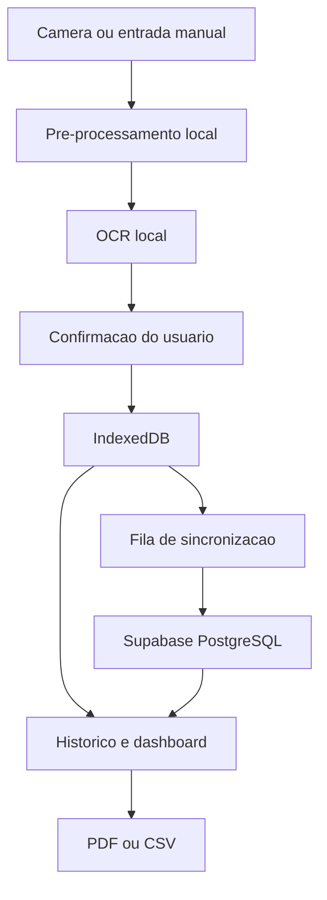

# CLAUDE.md - GlicoNexo PWA

## 1. Missao do projeto

Construir o **GlicoNexo**, uma aplicacao web progressiva (PWA), mobile-first, para apoiar o autogerenciamento glicemico de pessoas com Diabetes Mellitus Tipo 1 que utilizam glicosimetro capilar convencional.

O sistema deve permitir que o usuario:

- fotografe o visor do glicosimetro;
- extraia o valor numerico por OCR;
- revise e confirme o valor antes de salvar;
- registre a medicao manualmente quando preferir ou quando o OCR falhar;
- armazene e consulte seu historico;
- use as funcoes principais mesmo sem internet;
- visualize graficos e indicadores a partir da quarta medicao confirmada;
- exporte seus dados em PDF e CSV para uso pessoal ou compartilhamento com profissional de saude.

O GlicoNexo e uma ferramenta de **registro, organizacao e visualizacao de dados**. Ele nao pode diagnosticar, prescrever, calcular dose de insulina, substituir avaliacao profissional ou prometer melhora clinica.

## 2. Fontes utilizadas para definir o produto

Esta especificacao foi elaborada a partir de:

- `Trabalho de Conclusao de Curso I (TCC I).pdf`;
- `capitulos 1, 2 e 3 tcc.docx`.

Requisitos centrais encontrados nos documentos:

- publico principal: pessoas com DM1 que usam glicosimetro capilar;
- problema: valores isolados e registros manuais sujeitos a esquecimento e erro;
- solucao: captura por camera, OCR, armazenamento, historico, dashboards e exportacao;
- funcionamento offline e persistencia local;
- dashboards liberados a partir do quarto registro;
- agrupamento por momentos como cafe da manha, almoco, lanche da tarde e jantar;
- exportacao para computador e compartilhamento de relatorio;
- usabilidade simples, acessibilidade, seguranca e LGPD;
- suporte informacional, sem diagnostico ou intervencao clinica.

Os campos `U.C` e `U.D` aparecem na planilha de exemplo, mas nao estao definidos claramente nos documentos. **Nao inventar significado, calculo ou rotulo medico para eles.** Eles ficam fora do MVP ate validacao formal com o responsavel pelo produto e um profissional de saude.

## 3. Regra de trabalho para o Claude Code

Antes de modificar codigo:

1. analisar toda a estrutura existente do repositorio;
2. identificar framework, dependencias, rotas, autenticacao, banco, testes, PWA e componentes existentes;
3. procurar implementacoes relacionadas a glicemia, OCR, camera, historico, dashboard, exportacao, Supabase, IndexedDB e service worker;
4. verificar `package.json`, arquivos de lock, `.env.example`, configuracoes de deploy e migrations;
5. apresentar um resumo curto contendo:
   - situacao atual;
   - arquitetura encontrada;
   - o que sera criado ou alterado;
   - arquivos principais envolvidos;
   - riscos ou bloqueios reais.

Depois do resumo, executar a implementacao. Nao parar apenas no planejamento, salvo se faltar uma decisao que mude materialmente o produto, uma credencial obrigatoria ou autorizacao para uma acao destrutiva.

### Regras obrigatorias

- Se o repositorio estiver vazio, criar o projeto do zero.
- Se ja existir uma aplicacao, integrar a solucao sem recriar desnecessariamente.
- Nao apagar rotas, configuracoes, telas, integracoes ou funcionalidades existentes sem necessidade comprovada.
- Nao substituir a arquitetura atual apenas por preferencia pessoal.
- Nao fazer downgrade de framework ou dependencias para contornar incompatibilidades.
- Nao instalar versoes aleatorias. Conferir compatibilidade com o projeto e documentacao oficial atual.
- Nao inventar credenciais, URLs, chaves, IDs ou configuracoes externas.
- Nao colocar segredos no frontend, no Git ou em variaveis `NEXT_PUBLIC_*`.
- Nao usar dados reais do TCC como seed. Criar apenas dados sinteticos e claramente ficticios.
- Implementar por etapas pequenas, testaveis e reversiveis.
- Ao final de cada etapa, executar lint, checagem de tipos e testes relacionados.
- Atualizar README, migrations e documentacao junto com o codigo.

## 4. Escopo do MVP

### Incluido no MVP

- PWA instalavel;
- interface responsiva em portugues do Brasil;
- cadastro, login, recuperacao de senha e logout;
- onboarding e aceite dos termos/privacidade;
- registro de medicao por camera + OCR;
- registro manual;
- confirmacao obrigatoria antes de salvar leitura reconhecida por OCR;
- historico com filtros;
- edicao e exclusao de registros do proprio usuario;
- dashboard liberado a partir de quatro medicoes confirmadas;
- graficos por periodo e contexto;
- exportacao em PDF e CSV;
- banco PostgreSQL na nuvem;
- persistencia local com IndexedDB;
- criacao offline e sincronizacao posterior;
- isolamento dos dados por usuario com RLS;
- exportacao e exclusao dos dados pessoais;
- estados completos de carregamento, erro, vazio, offline e sincronizacao.

### Fora do MVP

- diagnostico;
- recomendacao de tratamento;
- calculadora ou sugestao de dose de insulina;
- decisao automatica baseada em uma leitura;
- previsao de crise glicemica;
- atendimento de emergencia;
- integracao com sensores de monitoramento continuo;
- integracao direta com glicosimetro por Bluetooth;
- portal para medico acessar todos os pacientes;
- compartilhamento publico de dados por URL;
- armazenamento permanente das fotos do glicosimetro;
- painel administrativo com acesso irrestrito a dados de saude;
- modulo da pesquisa academica e respostas do Google Forms.

O banco da pesquisa academica nao deve ser misturado com o banco de medicoes dos pacientes.

## 5. Stack recomendada

Se o repositorio nao tiver stack definida, utilizar:

- **Next.js**, App Router e TypeScript em modo estrito;
- **React**;
- **Tailwind CSS**;
- **shadcn/ui** ou componentes acessiveis equivalentes;
- **Supabase** para Auth e PostgreSQL;
- **Row Level Security** no banco;
- **IndexedDB com Dexie** para cache privado, fila offline e sincronizacao;
- **TanStack Query** para estado remoto e invalidacao de consultas;
- **React Hook Form + Zod** para formularios e validacao;
- **Tesseract.js**, carregado sob demanda, como primeiro provedor de OCR local;
- **Canvas API** para recorte e pre-processamento de imagem;
- biblioteca de graficos acessivel, como Recharts, desde que compativel com a aplicacao;
- biblioteca client-side confiavel para PDF;
- **Vitest** e Testing Library para testes unitarios e de componentes;
- **Playwright** para testes ponta a ponta;
- solucao PWA/service worker mantida e compativel com a versao atual do Next.js, como Serwist ou equivalente.

Nao trocar uma stack existente e funcional apenas para seguir esta lista. Quando houver projeto existente, adaptar as decisoes aos padroes ja usados.

### Variaveis de ambiente esperadas

Criar `.env.example` sem valores reais:

```env
NEXT_PUBLIC_SUPABASE_URL=
NEXT_PUBLIC_SUPABASE_ANON_KEY=
SUPABASE_SERVICE_ROLE_KEY=
NEXT_PUBLIC_APP_URL=http://localhost:3000
```

`SUPABASE_SERVICE_ROLE_KEY` so pode existir no servidor ou em Edge Function protegida. Nunca pode fazer parte do bundle do navegador.

## 6. Arquitetura esperada

Fluxo principal:



Principios:

- o navegador deve processar a foto localmente no MVP;
- a imagem nao deve ser enviada ao servidor nem persistida por padrao;
- a medicao recebe UUID no cliente para permitir criacao offline idempotente;
- a interface grava primeiro no repositorio local e tenta sincronizar em seguida;
- o PostgreSQL e a fonte persistente na nuvem;
- o IndexedDB permite uso offline, fila de alteracoes e leitura rapida;
- componentes React nao devem espalhar chamadas diretas ao Supabase;
- criar uma camada de repositorio e um servico de sincronizacao;
- regras de negocio e validacoes devem ficar fora dos componentes visuais;
- metricas devem ser funcoes puras e testadas;
- valores privados nao devem ser incluidos em logs, telemetria ou mensagens de erro.

Interfaces sugeridas:

```ts
interface MeasurementRepository {
  list(filters?: MeasurementFilters): Promise<GlucoseMeasurement[]>;
  getById(id: string): Promise<GlucoseMeasurement | null>;
  create(input: CreateMeasurementInput): Promise<GlucoseMeasurement>;
  update(id: string, input: UpdateMeasurementInput): Promise<GlucoseMeasurement>;
  remove(id: string): Promise<void>;
}

interface OcrProvider {
  recognize(input: Blob): Promise<OcrResult>;
}

interface SyncService {
  pushPending(): Promise<SyncSummary>;
  pullChanges(): Promise<SyncSummary>;
  sync(): Promise<SyncSummary>;
}
```

## 7. Estrutura de pastas sugerida

Adaptar ao repositorio se ele ja possuir convencoes:

```text
src/
  app/
    (public)/
      page.tsx
      entrar/
      cadastro/
      recuperar-senha/
    (protected)/
      app/
        page.tsx
        registrar/
        historico/
        historico/[id]/
        analises/
        relatorios/
        configuracoes/
        privacidade/
    api/
  components/
    ui/
    layout/
    feedback/
  features/
    auth/
    onboarding/
    measurements/
    ocr/
    dashboard/
    reports/
    sync/
    privacy/
  lib/
    supabase/
    db/
    offline/
    security/
    validation/
  types/
  styles/
public/
  icons/
  screenshots/
supabase/
  migrations/
  functions/
tests/
  unit/
  integration/
  e2e/
docs/
  architecture.md
  database.md
  privacy-and-security.md
  testing.md
```

## 8. Usuarios e permissoes

O MVP possui somente o papel funcional de **paciente/usuario dono dos dados**.

Regras:

- cada conta acessa somente seu perfil, preferencias, consentimentos e medicoes;
- nenhum usuario comum pode consultar ou alterar registros de outra conta;
- nao criar um papel `admin` com acesso global a dados de saude no MVP;
- suporte tecnico nao deve visualizar dados clinicos por padrao;
- relatorios sao gerados pelo proprio usuario;
- compartilhamento com profissional ocorre por arquivo exportado, sob acao explicita do usuario.

Se futuramente existir portal profissional, ele deve ser um modulo separado, com consentimento granular, vinculo explicito, prazo de acesso, auditoria e possibilidade de revogacao.

## 9. Navegacao e menu

### Mobile

Usar barra inferior com cinco destinos:

1. **Inicio**;
2. **Registrar** - acao principal e visualmente destacada;
3. **Historico**;
4. **Relatorios**;
5. **Perfil**.

### Desktop/tablet

Usar sidebar recolhivel com os mesmos destinos. Nao criar uma experiencia diferente; apenas reorganizar a mesma hierarquia.

### Rotas minimas

```text
/
/entrar
/cadastro
/recuperar-senha
/onboarding
/app
/app/registrar
/app/historico
/app/historico/[id]
/app/analises
/app/relatorios
/app/configuracoes
/app/privacidade
```

Rotas protegidas devem validar sessao no servidor quando online e impedir vazamento de conteudo durante redirecionamentos.

## 10. Telas e requisitos detalhados

### 10.1 Pagina publica

- nome GlicoNexo;
- explicacao curta do beneficio;
- aviso de que nao substitui acompanhamento medico;
- botoes `Criar conta` e `Entrar`;
- link para privacidade e termos;
- sem promessas de resultado clinico.

### 10.2 Cadastro, login e recuperacao

- e-mail e senha;
- validacao clara;
- confirmar e-mail se a configuracao do Supabase exigir;
- mensagens de erro seguras, sem expor detalhes internos;
- recuperacao de senha;
- protecao contra redirecionamento aberto;
- logout com tratamento de alteracoes offline pendentes.

Se houver registros ainda nao sincronizados no logout:

- tentar sincronizar quando online;
- se estiver offline, avisar sobre os registros pendentes;
- nao apagar silenciosamente dados ainda nao sincronizados;
- permitir cancelar o logout ou exportar/aguardar sincronizacao;
- depois de um logout concluido, remover dados privados locais daquela conta.

### 10.3 Onboarding

No maximo quatro passos:

1. objetivo do aplicativo;
2. como fotografar o glicosimetro;
3. explicacao sobre historico, offline e relatorios;
4. privacidade, limites do produto e consentimento.

Registrar versao dos termos e da politica aceita. O consentimento para tratamento de dados de saude deve ser destacado, especifico e revogavel conforme o fluxo definido pelo produto.

### 10.4 Inicio

Exibir:

- saudacao simples;
- status online/offline;
- quantidade de alteracoes aguardando sincronizacao;
- botao grande `Registrar glicemia`;
- ultima medicao confirmada, com valor, data, horario e contexto;
- resumo do periodo selecionado;
- atalho para historico;
- aviso informativo discreto.

Antes de quatro medicoes:

- nao mostrar graficos vazios ou estatisticas enganosas;
- mostrar progresso `X de 4 medicoes registradas`;
- explicar que os graficos serao exibidos depois da quarta medicao;
- manter historico e exportacao dos registros disponiveis.

A partir da quarta medicao confirmada:

- mostrar grafico resumido;
- media do periodo;
- menor e maior valor;
- quantidade de registros;
- distribuicao abaixo, dentro e acima da faixa configurada;
- link `Ver analise completa`.

Usar linguagem informacional: `abaixo da faixa configurada`, `dentro da faixa configurada` e `acima da faixa configurada`. Nao transformar classificacao em diagnostico.

### 10.5 Registrar medicao

Oferecer duas opcoes igualmente acessiveis:

- `Usar camera`;
- `Digitar valor`.

Campos do registro:

- valor em mg/dL, obrigatorio;
- data e horario, preenchidos com o momento atual, mas editaveis;
- periodo/contexto;
- relacao com refeicao, opcional;
- observacao curta, opcional;
- origem `ocr` ou `manual`, definida pelo sistema.

Contextos sugeridos:

```text
jejum
cafe_da_manha
almoco
lanche_da_tarde
jantar
antes_de_dormir
madrugada
atividade_fisica
outro
```

Relacao com refeicao:

```text
antes
depois
nao_informado
```

Nao adicionar campos de dose, correcao de insulina ou carboidratos sem decisao explicita do produto e revisao de seguranca clinica.

### 10.6 Camera e OCR

Fluxo obrigatorio:

1. solicitar permissao somente quando o usuario tocar em `Usar camera`;
2. abrir camera traseira quando disponivel;
3. mostrar moldura para alinhar apenas o visor;
4. permitir fotografar ou selecionar imagem existente;
5. permitir recortar e girar;
6. executar pre-processamento local;
7. executar OCR com caracteres permitidos `0-9`;
8. extrair candidatos numericos;
9. exibir foto temporaria, valor sugerido e nivel de confianca;
10. obrigar o usuario a confirmar ou corrigir;
11. salvar apenas depois da confirmacao;
12. descartar e revogar a imagem temporaria apos salvar ou cancelar.

Pre-processamento inicial:

- recorte da area selecionada;
- correcao de orientacao;
- escala de cinza;
- aumento de contraste;
- limiarizacao/binarizacao;
- reducao simples de ruido;
- testar variacoes de limiar e selecionar o candidato mais consistente.

Regras do OCR:

- carregar engine e modelos somente quando necessarios;
- exibir progresso de carregamento e processamento;
- nunca salvar automaticamente, mesmo com confianca alta;
- se houver baixa confianca ou varios candidatos, destacar que a revisao e necessaria;
- se nao houver resultado, manter a foto temporaria e abrir entrada manual;
- aceitar correcao completa pelo usuario;
- registrar apenas valor confirmado, origem, confianca e versao do mecanismo;
- nao registrar a foto por padrao;
- nao enviar a foto para servico externo no MVP;
- usar fallback com `<input type="file" accept="image/*" capture="environment">` quando `getUserMedia` nao estiver disponivel;
- tratar permissao negada com instrucao curta e alternativa manual.

Criar a implementacao de OCR atras da interface `OcrProvider` para permitir troca futura sem reescrever a tela.

### 10.7 Confirmacao da leitura

Mostrar:

- imagem recortada temporaria;
- valor reconhecido em campo editavel;
- unidade `mg/dL`;
- data/hora;
- contexto;
- observacao;
- aviso `Confira o valor no visor antes de salvar`;
- botoes `Confirmar e salvar`, `Tentar novamente` e `Cancelar`.

Validacao tecnica inicial do valor: numero inteiro entre 1 e 999. Esta validacao existe para qualidade do dado, nao para diagnostico. Nao bloquear silenciosamente; explicar o erro de formato.

### 10.8 Registro manual

- teclado numerico em dispositivos moveis;
- unidade sempre visivel;
- data/hora e contexto;
- mesma validacao usada no OCR;
- confirmacao antes de concluir;
- funcionamento offline.

### 10.9 Historico

Exibir lista ou agrupamento por dia com:

- valor;
- horario;
- contexto;
- origem manual/OCR;
- indicador de sincronizacao;
- classificacao visual pela faixa configurada, sem depender apenas de cor.

Filtros:

- 7, 30 e 90 dias;
- periodo personalizado;
- contexto;
- abaixo/dentro/acima da faixa;
- origem manual/OCR.

Funcoes:

- busca/filtragem local quando offline;
- abrir detalhe;
- editar;
- excluir com confirmacao;
- desfazer exclusao local por curto periodo antes da sincronizacao, quando viavel;
- paginacao ou carregamento progressivo para historicos longos.

### 10.10 Detalhe e edicao

- exibir todos os campos da medicao;
- permitir corrigir valor, horario, contexto e observacao;
- preservar origem original;
- registrar `updated_at` e versao para sincronizacao;
- exclusao logica com `deleted_at` para permitir sincronizacao entre dispositivos;
- nao manter copia da imagem original.

### 10.11 Analises e dashboard

So calcular com medicoes confirmadas e nao excluidas.

Filtros:

- 7 dias;
- 30 dias;
- 90 dias;
- mes atual;
- periodo personalizado;
- contexto.

Indicadores:

- ultima medicao;
- media aritmetica do periodo;
- menor valor;
- maior valor;
- total de medicoes;
- percentual abaixo da faixa configurada;
- percentual dentro da faixa configurada;
- percentual acima da faixa configurada.

Graficos:

- linha temporal de glicemia;
- series por cafe da manha, almoco, lanche da tarde, jantar e outros contextos;
- faixas de fundo baseadas nas configuracoes do usuario;
- grafico de distribuicao por faixa;
- quantidade de medicoes por dia/contexto.

Regras de calculo e apresentacao:

- respeitar timezone do usuario;
- nao interpolar dias sem dados;
- informar quantidade de registros usada no calculo;
- nao projetar tendencia futura;
- nao sugerir dose ou conduta;
- evitar termos alarmistas;
- oferecer tabela textual acessivel equivalente aos graficos;
- tooltips devem funcionar por toque e teclado;
- cores devem ter rotulos, padroes ou icones equivalentes.

### 10.12 Relatorios e exportacao

Permitir escolher periodo e formato.

PDF deve conter:

- titulo GlicoNexo;
- identificacao opcional escolhida pelo usuario;
- periodo;
- data/hora de geracao;
- resumo numerico;
- grafico principal;
- tabela cronologica de medicoes;
- contexto de cada medicao;
- observacoes apenas se o usuario marcar essa opcao;
- faixa configurada pelo usuario;
- aviso de que o documento e informativo e nao substitui avaliacao profissional.

CSV deve:

- usar UTF-8;
- possuir cabecalhos claros em portugues;
- incluir ISO timestamp e horario local;
- incluir valor, unidade, contexto, relacao com refeicao, origem e observacao;
- escapar corretamente virgulas, aspas e quebras de linha.

Quando `Web Share API` estiver disponivel, permitir compartilhar o arquivo. Sempre manter download como fallback. Nao enviar relatorio automaticamente por e-mail ou para terceiros.

### 10.13 Perfil e configuracoes

- nome de exibicao opcional;
- timezone;
- tema claro, escuro ou sistema;
- faixa pessoal inferior e superior;
- explicacao de que a faixa deve refletir orientacao profissional;
- opcao de instalar PWA;
- status de sincronizacao;
- exportar todos os dados;
- revogar consentimento conforme fluxo definido;
- excluir conta e dados;
- politica de privacidade;
- termos de uso;
- versao do aplicativo.

Nao definir uma faixa pessoal como recomendacao medica do aplicativo. Se forem usados valores iniciais para demonstracao, rotula-los como exemplo e exigir confirmacao do usuario.

## 11. Modelo de dados PostgreSQL

Criar migrations versionadas. Nao editar banco manualmente sem migration equivalente.

### 11.1 `profiles`

```text
id uuid primary key references auth.users(id) on delete cascade
display_name text null
timezone text not null default 'America/Sao_Paulo'
onboarding_completed_at timestamptz null
created_at timestamptz not null default now()
updated_at timestamptz not null default now()
```

### 11.2 `user_preferences`

```text
user_id uuid primary key references auth.users(id) on delete cascade
glucose_unit text not null default 'mg/dL'
target_min_mg_dl smallint null
target_max_mg_dl smallint null
theme text not null default 'system'
created_at timestamptz not null default now()
updated_at timestamptz not null default now()
```

Restricoes:

- unidade do MVP deve ser `mg/dL`;
- quando as duas metas existirem: `target_min_mg_dl < target_max_mg_dl`;
- valores entre 1 e 999;
- tema em `light`, `dark` ou `system`.

### 11.3 `glucose_measurements`

```text
id uuid primary key
user_id uuid not null references auth.users(id) on delete cascade
value_mg_dl smallint not null
measured_at timestamptz not null
timezone text not null
context text not null
meal_relation text not null default 'nao_informado'
source text not null
ocr_confidence real null
ocr_engine_version text null
notes text null
version integer not null default 1
created_at timestamptz not null default now()
updated_at timestamptz not null default now()
deleted_at timestamptz null
```

Restricoes:

- `value_mg_dl` entre 1 e 999;
- `context` limitado aos valores suportados;
- `meal_relation` em `antes`, `depois`, `nao_informado`;
- `source` em `manual`, `ocr`;
- `ocr_confidence` entre 0 e 1 quando presente;
- observacao com limite de 1000 caracteres;
- indice por `(user_id, measured_at desc)`;
- indice por `(user_id, updated_at)` para sincronizacao;
- indice parcial de registros ativos, se vantajoso;
- `updated_at` atualizado por trigger confiavel;
- UUID gerado no cliente tambem aceito pelo banco.

### 11.4 `consent_records`

```text
id uuid primary key
user_id uuid not null references auth.users(id) on delete cascade
consent_type text not null
document_version text not null
accepted_at timestamptz not null
revoked_at timestamptz null
created_at timestamptz not null default now()
```

Guardar somente informacoes necessarias para demonstrar o aceite. Nao registrar valor glicemico em logs de consentimento.

### 11.5 Eventos tecnicos

Se houver tabela de auditoria, registrar somente eventos como login, exportacao, exclusao de conta e falha de sincronizacao, sem copiar valores glicemicos, observacoes ou conteudo de relatorio.

## 12. Row Level Security

Ativar RLS em todas as tabelas de usuario.

Politicas obrigatorias:

- `profiles`: `auth.uid() = id` para leitura e alteracao;
- `user_preferences`: `auth.uid() = user_id`;
- `glucose_measurements`: `auth.uid() = user_id` para select, insert, update e delete;
- `consent_records`: `auth.uid() = user_id`;
- usar `WITH CHECK` em insert/update, nao somente `USING`;
- negar tudo por padrao;
- nenhuma policy pode confiar em `user_id` enviado sem comparar com `auth.uid()`;
- nao expor tabela sensivel ao papel anonimo;
- service role somente em funcao server-side especifica e auditada.

Criar testes de RLS com no minimo:

1. usuario A cria e le a propria medicao;
2. usuario A nao le a medicao do usuario B;
3. usuario A nao altera nem exclui a medicao do usuario B;
4. usuario A nao consegue inserir registro com `user_id` de B;
5. usuario anonimo nao acessa medicoes;
6. exclusao da conta remove dados vinculados conforme politica definida.

## 13. Banco local e sincronizacao offline

Para PWA, substituir o SQLite proposto no TCC por **IndexedDB**. Nao usar `localStorage` para medicoes.

Stores locais sugeridas:

```text
measurements
outbox
sync_metadata
cached_profile
cached_preferences
```

### Estrategia de escrita

1. validar entrada com Zod;
2. gerar UUID no cliente;
3. salvar localmente como `pending`;
4. atualizar a interface imediatamente;
5. quando online, enviar ao Supabase com operacao idempotente;
6. marcar como `synced` apos resposta confirmada;
7. manter erro recuperavel com tentativa manual e automatica.

### Estrategia de leitura

- mostrar primeiro cache local;
- buscar alteracoes remotas quando online;
- mesclar por `id`, `version` e `updated_at`;
- atualizar IndexedDB e consultas visiveis;
- nunca duplicar uma medicao depois de retry.

### Edicao e exclusao

- toda alteracao entra na outbox;
- exclusao usa tombstone `deleted_at` ate sincronizar;
- manter operacoes idempotentes;
- impedir duas sincronizacoes concorrentes com mutex;
- retry com backoff e limite;
- mostrar quantidade pendente;
- oferecer botao `Sincronizar agora`.

### Conflitos

- utilizar `version` otimista;
- se a versao do servidor mudou, nao sobrescrever silenciosamente;
- para campos editaveis, exibir conflito simples com data das versoes quando necessario;
- para a primeira versao do MVP, pode usar `server wins` somente para registros ja sincronizados, desde que mudancas locais pendentes nunca sejam descartadas sem aviso;
- documentar a estrategia em `docs/architecture.md`.

### Privacidade local

- nao guardar imagens na outbox;
- nao usar Cache Storage para respostas autenticadas com dados de saude;
- Cache Storage deve guardar apenas shell e assets publicos;
- limpar dados privados locais depois de logout concluido;
- separar dados locais por `user_id`;
- nao exibir dados locais se nao houver uma sessao local valida para o mesmo usuario;
- documentar que IndexedDB em PWA possui limitacoes de protecao em dispositivo comprometido;
- se aplicar Web Crypto, documentar modelo de chave e ameacas que ele realmente mitiga, sem prometer criptografia absoluta.

## 14. PWA

Implementar:

- `manifest.webmanifest` valido;
- nome `GlicoNexo` e nome curto;
- `start_url` apropriada;
- modo `standalone`;
- cor de tema e fundo;
- icones 192x192 e 512x512;
- icone maskable;
- metadados para iOS;
- service worker com atualizacao controlada;
- pagina ou estado offline;
- indicador quando existir nova versao;
- botao de instalacao quando o navegador permitir;
- instrucao curta de `Adicionar a Tela de Inicio` no iOS;
- camera somente em contexto seguro HTTPS, exceto localhost;
- teste de instalabilidade em build de producao.

Estrategia de cache:

- cache-first para icones, fontes locais e assets versionados;
- stale-while-revalidate para recursos publicos seguros;
- network-only ou no-store para autenticacao e operacoes sensiveis;
- nao cachear HTML autenticado com dados privados no service worker;
- dados offline privados ficam no IndexedDB, nao no cache HTTP.

## 15. Seguranca e LGPD

Tratar glicemia como dado pessoal sensivel.

Obrigatorio:

- HTTPS em producao;
- RLS e menor privilegio;
- validacao Zod no cliente e validacao equivalente no servidor/banco;
- cookies e sessoes configurados com seguranca compativel com o framework;
- protecao contra XSS, CSRF quando aplicavel e redirecionamento aberto;
- Content Security Policy compativel com camera, OCR worker e Supabase;
- headers `X-Content-Type-Options`, `Referrer-Policy` e `Permissions-Policy` adequados;
- limitar `camera` as origens necessarias;
- sanitizar observacoes antes de renderizar/exportar;
- rate limiting nas rotas server-side sensiveis;
- nenhuma medicao em analytics, logs, Sentry breadcrumbs ou URLs;
- nenhuma informacao sensivel em query string;
- dependencia de terceiros minima e documentada;
- formulario de privacidade com exportacao e exclusao;
- politica clara de retencao;
- nao armazenar imagem do glicosimetro por padrao;
- consentimento explicito antes do tratamento de dados de saude;
- revogacao e exclusao conforme fluxo documentado;
- backups e ambientes de desenvolvimento sem dados reais.

### Exclusao de conta

Implementar funcao server-side ou Supabase Edge Function que:

1. valida o JWT;
2. identifica o usuario pela sessao, nunca por `user_id` do frontend;
3. apaga ou agenda apagamento dos dados conforme politica documentada;
4. exclui a conta de autenticacao usando credencial server-side;
5. retorna resultado generico;
6. limpa dados locais apos sucesso;
7. nao expoe service role.

Nao declarar que o sistema esta `em conformidade total com a LGPD` apenas porque estas funcoes existem. Registrar pendencias juridicas e operacionais separadamente.

## 16. Acessibilidade e UX

- mobile-first;
- idioma `pt-BR`;
- texto base legivel;
- alvos de toque com pelo menos 44x44 px;
- contraste WCAG AA;
- navegacao por teclado;
- foco visivel;
- labels reais em todos os campos;
- `aria-live` para resultado de OCR, sincronizacao e erros;
- graficos com resumo textual e tabela equivalente;
- estados nao identificados somente por cor;
- modo escuro acessivel;
- nao usar animacoes que prejudiquem leitura;
- respeitar `prefers-reduced-motion`;
- mensagens curtas, claras e sem jargao tecnico;
- formularios devem preservar dados digitados diante de erro recuperavel;
- loading com contexto, evitando tela branca;
- skeletons apenas onde melhorarem compreensao;
- empty states com proxima acao clara.

Paleta sugerida, caso nao exista identidade visual:

- azul profundo para estrutura e confianca;
- azul-claro/ciano para acao principal;
- verde, amarelo e vermelho apenas como apoio semantico, sempre acompanhados de texto ou icone;
- fundo claro neutro e alto contraste;
- evitar aparencia hospitalar fria ou interface infantil.

## 17. Regras de negocio

1. Medicao OCR so existe depois da confirmacao do usuario.
2. Medicao manual e OCR utilizam o mesmo schema e as mesmas validacoes.
3. Dashboard completo e liberado com quatro medicoes confirmadas.
4. Registros excluidos nao entram em metricas ou relatorios.
5. Dias sem medicao permanecem sem ponto; nao interpolar.
6. Filtros e metricas respeitam timezone do usuario.
7. Faixas sao preferencias informacionais do usuario, nao prescricao.
8. Se a faixa nao estiver configurada, mostrar graficos sem classificar abaixo/dentro/acima.
9. Nenhum calculo pode sugerir insulina ou conduta.
10. Nenhuma foto e persistida sem uma futura decisao explicita e consentimento especifico.
11. Dados pendentes offline nao podem desaparecer silenciosamente.
12. Operacoes de sync devem ser idempotentes.
13. Registros de outro usuario nunca podem aparecer, mesmo por cache local.
14. Exportacao deve usar exatamente o periodo e os filtros confirmados.
15. Uma falha de OCR nunca deve impedir digitacao manual.

## 18. Estados que toda tela deve tratar

- carregando;
- sem dados;
- erro recuperavel;
- erro sem permissao;
- offline;
- sincronizacao pendente;
- sincronizacao em andamento;
- sincronizacao com falha;
- sucesso;
- sessao expirada;
- camera indisponivel;
- permissao de camera negada;
- OCR carregando;
- OCR sem resultado;
- OCR com baixa confianca;
- exportacao sem registros;
- exportacao em andamento;
- conflito de edicao.

Nao usar apenas `console.error`. Exibir mensagem util ao usuario e registrar erro tecnico sem dados sensiveis.

## 19. Testes obrigatorios

### Unitarios

- schemas Zod;
- parser de candidatos do OCR;
- rejeicao de texto sem numero;
- calculo de media, minimo, maximo e percentuais;
- regra de quatro medicoes;
- filtros por periodo/contexto;
- timezone e mudanca de dia;
- geracao e escape do CSV;
- merge e idempotencia da sincronizacao;
- exclusao logica;
- classificacao por faixa configurada.

### Componentes

- formulario manual;
- confirmacao OCR;
- permissao negada;
- progresso `X de 4`;
- historico vazio;
- filtros;
- indicador offline;
- registros pendentes;
- dialogo de exclusao;
- configuracao de faixa;
- graficos com alternativa textual.

### Integracao

- Auth + criacao de perfil;
- CRUD de medicao;
- RLS entre dois usuarios;
- IndexedDB + outbox;
- criacao offline e sincronizacao ao reconectar;
- retry sem duplicacao;
- edicao e tombstone;
- exportacao de um periodo;
- exclusao de conta.

### E2E

Fluxo minimo:

1. criar conta;
2. concluir onboarding;
3. registrar tres medicoes manualmente;
4. confirmar que dashboard completo ainda esta bloqueado;
5. registrar quarta medicao;
6. visualizar grafico e metricas;
7. capturar OCR usando fixture de imagem no teste;
8. corrigir valor reconhecido;
9. filtrar historico;
10. editar e excluir uma medicao;
11. exportar CSV e PDF;
12. simular offline, criar medicao e sincronizar ao reconectar;
13. sair e confirmar limpeza do cache privado conforme regras.

Nao depender de camera fisica no CI. Injetar arquivo de teste e mockar `getUserMedia` quando necessario.

### Seguranca

- usuario A nao acessa usuario B;
- anonimo nao acessa rotas privadas nem tabelas;
- service role nao aparece no bundle;
- observacao maliciosa nao executa HTML/JavaScript;
- URLs nao recebem valores glicemicos;
- service worker nao cacheia resposta privada;
- logs nao incluem leitura, observacao ou relatorio.

## 20. Qualidade e desempenho

- TypeScript estrito sem `any` evitavel;
- lint sem erros;
- build de producao concluido;
- testes aprovados;
- OCR carregado por lazy loading;
- graficos carregados apenas onde usados;
- imagens temporarias redimensionadas antes do OCR;
- liberar memoria e revogar object URLs;
- historico com consulta paginada;
- evitar re-renderizacao do grafico a cada digitacao;
- bundle principal nao deve incluir engine OCR se o usuario nao abrir a camera;
- medir desempenho em aparelho intermediario;
- nenhuma falha visual em 320 px de largura;
- testar Chrome Android, Safari iOS, Edge/Chrome desktop;
- documentar limitacoes especificas do iOS PWA.

## 21. Implementacao por fases

### Fase 0 - Auditoria

- analisar repositorio;
- confirmar stack;
- listar arquivos e alteracoes;
- registrar decisoes que divergirem desta proposta.

### Fase 1 - Base do projeto

- scaffold ou adaptacao;
- TypeScript estrito;
- layout responsivo;
- tema;
- rotas publicas e protegidas;
- Supabase client/server;
- `.env.example`;
- lint, testes e CI basico.

### Fase 2 - Banco e autenticacao

- migrations;
- RLS;
- cadastro/login/recuperacao/logout;
- perfil e preferencias;
- consentimentos;
- testes de isolamento.

### Fase 3 - Registro manual e historico

- schema compartilhado;
- repositorio;
- formulario manual;
- IndexedDB;
- CRUD;
- historico e filtros;
- estados offline.

### Fase 4 - Sincronizacao

- outbox;
- push/pull;
- idempotencia;
- retry e backoff;
- conflitos;
- indicadores visuais;
- testes offline/online.

### Fase 5 - Camera e OCR

- permissao;
- captura e fallback;
- recorte/pre-processamento;
- provider Tesseract;
- confirmacao obrigatoria;
- descarte da foto;
- fixtures e testes.

### Fase 6 - Dashboard

- regra de quatro medicoes;
- filtros;
- metricas;
- graficos acessiveis;
- faixas configuraveis;
- testes de calculo.

### Fase 7 - Relatorios e privacidade

- PDF;
- CSV;
- Web Share API;
- exportacao completa;
- exclusao de conta;
- politica/termos placeholders claramente marcados para revisao juridica.

### Fase 8 - PWA e endurecimento

- manifest;
- icones;
- service worker;
- instalacao;
- estrategia de cache;
- headers de seguranca;
- acessibilidade;
- testes cross-browser;
- build e checklist final.

Nao iniciar a fase seguinte deixando erro conhecido na anterior. Pequenas pendencias devem ficar registradas com impacto e responsavel.

## 22. Entregaveis esperados

- aplicacao PWA funcional;
- banco e migrations versionadas;
- RLS e testes de RLS;
- autenticacao completa;
- OCR local com confirmacao;
- entrada manual;
- IndexedDB e sync;
- historico;
- dashboard;
- PDF e CSV;
- configuracoes e privacidade;
- testes unitarios, integracao e E2E essenciais;
- `.env.example`;
- README com instalacao local, Supabase, migrations, testes, build e deploy;
- `docs/architecture.md`;
- `docs/database.md`;
- `docs/privacy-and-security.md`;
- `docs/testing.md`;
- lista clara de limitacoes e proximos passos.

## 23. Criterios de aceite do MVP

O MVP sera considerado concluido quando:

- puder ser instalado como PWA em build de producao;
- funcionar de forma responsiva em celular e desktop;
- o usuario puder criar conta e acessar somente os proprios dados;
- uma medicao puder ser registrada manualmente offline;
- uma foto puder ser processada por OCR sem upload ao servidor;
- o valor OCR sempre exigir confirmacao;
- falha do OCR oferecer entrada manual;
- medicoes offline sincronizarem sem duplicacao;
- o historico permitir filtro, edicao e exclusao;
- o dashboard aparecer somente a partir da quarta medicao;
- as metricas corresponderem aos dados filtrados;
- PDF e CSV forem gerados corretamente;
- nenhuma foto ficar armazenada por padrao;
- RLS impedir acesso cruzado entre usuarios;
- service worker nao armazenar respostas privadas;
- exclusao de conta e exportacao de dados estiverem disponiveis;
- lint, tipos, testes e build estiverem aprovados;
- README permitir que outro desenvolvedor execute o projeto;
- limitacoes medicas, juridicas e tecnicas estiverem documentadas.

## 24. Formato da entrega do Claude Code

Ao terminar, apresentar de forma objetiva:

1. o que foi implementado;
2. principais arquivos criados/alterados;
3. migrations adicionadas;
4. testes executados e resultados;
5. como rodar localmente;
6. como configurar Supabase;
7. como testar PWA e modo offline;
8. pendencias reais;
9. riscos que ainda precisam de validacao clinica, juridica ou de produto.

Nao afirmar que algo esta pronto se nao foi executado ou validado. Nao esconder falhas de teste, dependencia de credencial ou limitacao do navegador.

## 25. Roadmap depois do MVP

Somente depois da validacao do PWA:

- compartilhamento seguro e revogavel com profissional de saude;
- lembretes opt-in;
- suporte a mmol/L com conversao testada;
- integracao com dispositivos, quando houver API oficial;
- aplicativo nativo usando a mesma regra de negocio;
- melhoria do OCR com conjunto de imagens anonimizadas e consentidas;
- pesquisa de usabilidade com publico-alvo;
- painel de qualidade do OCR sem coletar valores ou imagens sensiveis;
- backup criptografado e restauracao entre dispositivos;
- acessibilidade ampliada para usuarios idosos ou com baixa visao.

Qualquer recurso que interprete clinicamente leituras, gere alertas medicos ou influencie dose exige avaliacao especializada, requisitos regulatorios e validacao propria antes de entrar no produto.
