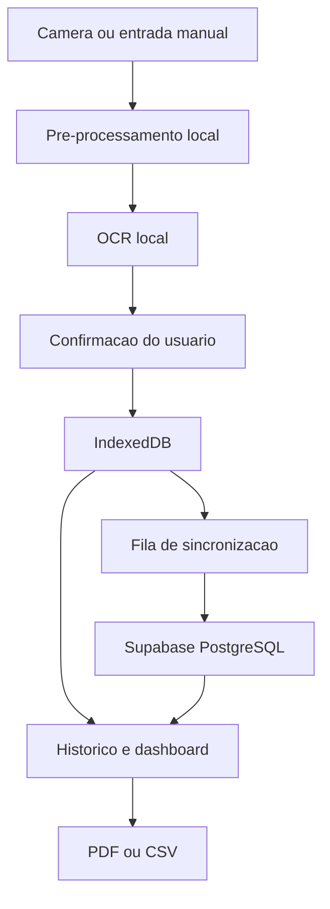

# Arquitetura — GlicoNexo

## Visão geral

O GlicoNexo é um PWA em Next.js (App Router) + TypeScript estrito. A
arquitetura alvo, descrita em `CLAUDE.md` (seção 6), processa a foto do
glicosímetro localmente no navegador (nunca no servidor), grava primeiro
no repositório local e sincroniza em segundo plano com o Supabase.



## Estado implementado nesta entrega (Fase 1 + Fase 3 parcial)

- `src/app/(public)/*` — rotas públicas (landing, entrar, cadastro,
  recuperar senha, privacidade, termos).
- `src/app/onboarding` — fluxo de 4 passos, sem persistência do aceite.
- `src/app/(protected)/app/*` — casca do app autenticado, com todas as
  rotas do MVP (`início`, `registrar`, `histórico`, `histórico/[id]`,
  `análises`, `relatórios`, `configurações`, `privacidade`), navegação
  inferior no mobile e sidebar no desktop.
- `src/lib/supabase/client.ts` e `src/lib/supabase/server.ts` — clientes
  Supabase (browser/servidor) usando `@supabase/ssr`, prontos para receber
  credenciais reais quando a conta do produto existir (ver
  `docs/database.md` — pendência registrada).
- `src/features/measurements/schemas.ts` — schema Zod único, compartilhado
  entre o fluxo manual e o futuro fluxo de confirmação OCR (regra 2 da
  seção 17 do `CLAUDE.md`).
- **`MeasurementRepository` sobre IndexedDB/Dexie** (`src/lib/db/`) — ver
  seção dedicada abaixo. Registrar, editar, excluir (com desfazer) e
  listar/filtrar medições já funciona de ponta a ponta, salvando de
  verdade no navegador.

## Camada de dados local (implementada)

```ts
interface MeasurementRepository {
  list(filters?: MeasurementFilters): Promise<GlucoseMeasurement[]>;
  getById(id: string): Promise<GlucoseMeasurement | null>;
  create(input: CreateMeasurementInput): Promise<GlucoseMeasurement>;
  update(id: string, input: UpdateMeasurementInput): Promise<GlucoseMeasurement>;
  remove(id: string): Promise<void>;
}
```

`src/lib/db/measurement-repository.ts` implementa essa interface sobre
Dexie (`src/lib/db/schema.ts`, banco `gliconexo`, tabela `measurements`),
com um método extra `restore(id)` para o "desfazer" de exclusões
recentes na UI do histórico. Decisões relevantes:

- UUID gerado no cliente (`crypto.randomUUID()`) em `create`, permitindo
  registro offline idempotente quando a sincronização existir.
- Exclusão lógica (`deletedAt`) em vez de exclusão física, com `version`
  incrementado a cada `update`/`remove`/`restore` — já preparado para a
  estratégia de conflito otimista da Fase 4 (ver abaixo).
- `getDb()` instancia o Dexie sob demanda (nunca no import), porque
  `new Dexie(...)` exige `indexedDB`, que não existe durante a
  renderização no servidor (Next.js roda em Node).
- Componentes de UI leem os dados via `dexie-react-hooks`
  (`useLiveQuery`), não via `fetch`/estado manual — a tela atualiza
  sozinha quando outro componente grava no mesmo banco.
- Filtros (período/contexto/origem) e agrupamento por dia
  (`src/features/measurements/filter-measurements.ts`) e estatísticas
  (`src/features/measurements/stats.ts`) são funções puras, testadas em
  `tests/unit/`, mantendo essa lógica fora dos componentes visuais
  (CLAUDE.md, seção 6, "metricas devem ser funcoes puras e testadas").

**Ainda não implementado nesta camada:** nenhum dado é escopado por
`user_id` (não existe autenticação ainda — todo o dispositivo é uma
"conta local" única) nem limpo em um logout (que também não existe);
isso é trabalho da Fase 2/4, junto da privacidade local descrita na
seção 13 do `CLAUDE.md`. Nada sincroniza com o Supabase ainda — é por
isso que todo registro aparece com o selo "Pendente" no histórico.

## Camadas ainda planejadas (fases seguintes)

```ts
interface OcrProvider {
  recognize(input: Blob): Promise<OcrResult>;
}

interface SyncService {
  pushPending(): Promise<SyncSummary>;
  pullChanges(): Promise<SyncSummary>;
  sync(): Promise<SyncSummary>;
}
```

- `OcrProvider` — implementado com Tesseract.js na Fase 5, carregado sob
  demanda (o bundle principal não deve incluir o engine OCR).
- `SyncService` — outbox + fila de sincronização com o Supabase, criada na
  Fase 4, reaproveitando o `version`/`deletedAt` já presentes no schema
  local.

## Decisões de Next.js 16

Este projeto foi criado com Next.js 16, que trouxe mudanças relevantes em
relação ao que a maioria dos modelos de IA "conhece" de treinamento (ver
`node_modules/next/dist/docs/`, referenciado em `AGENTS.md`):

- `cookies()` e `headers()` são assíncronos — `src/lib/supabase/server.ts`
  já usa `await cookies()`.
- Middleware foi renomeado para `proxy.ts` — ainda não existe neste
  projeto porque a validação de sessão no servidor (`CLAUDE.md`, seção 9)
  será implementada junto da autenticação real, na Fase 2.
- O manifest da PWA é gerado via `src/app/manifest.ts` (convenção nativa
  do App Router), não como um `public/manifest.webmanifest` estático.
- Turbopack é o bundler padrão para `dev` e `build`.

## Estratégia de conflito de sincronização (planejada)

Conforme `CLAUDE.md` seção 13: a versão otimista (`version`) evita
sobrescrita silenciosa. Para a primeira versão do MVP, "server wins" será
usado apenas para registros já sincronizados; alterações locais pendentes
nunca serão descartadas sem aviso ao usuário. Esta estratégia ainda não
foi implementada.

## Limitações conhecidas desta entrega

- Sem service worker: mesmo com dados salvos em IndexedDB, o app ainda
  não é servido offline de fato (o shell/HTML depende da rede).
- Dados locais não são escopados por usuário nem sincronizam entre
  dispositivos — só existe uma "conta local" por navegador.
- Sem RLS/migrations: não há banco remoto real conectado (pendência de
  produto registrada em `docs/database.md`).
- Sem OCR: a opção "Usar câmera" mostra um estado "em breve".
