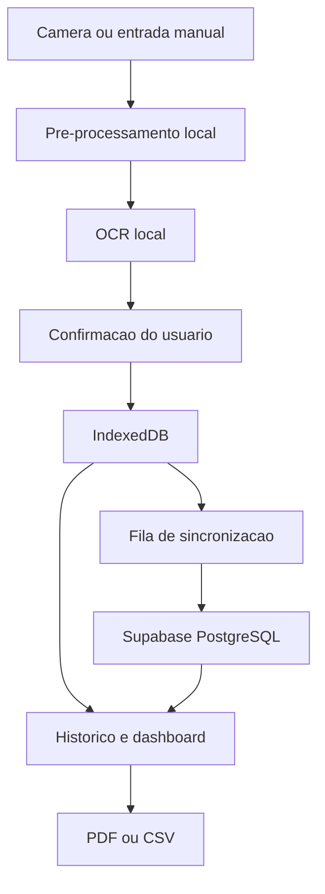

# Arquitetura — GlicoNexo

## Visão geral

O GlicoNexo é um PWA em Next.js (App Router) + TypeScript estrito. A
arquitetura alvo, descrita em `CLAUDE.md` (seção 6), processa a foto do
glicosímetro localmente no navegador (nunca no servidor), grava primeiro
no repositório local e sincroniza em segundo plano com o Supabase.



## Estado implementado nesta entrega (Fase 1, Fase 3 parcial, Fase 5, gráfico da Fase 6, exportação da Fase 7)

- `src/app/(public)/*` — rotas públicas (landing, entrar, cadastro,
  recuperar senha, privacidade, termos).
- `src/app/onboarding` — fluxo de 4 passos, sem persistência do aceite.
- `src/app/(protected)/app/*` — casca do app autenticado, com todas as
  rotas do MVP (`início`, `registrar`, `histórico`, `histórico/[id]`,
  `análises`, `relatórios`, `configurações`, `privacidade`), navegação
  inferior no mobile e sidebar no desktop.
- `src/lib/supabase/client.ts` e `src/lib/supabase/server.ts` — clientes
  Supabase (browser/servidor) usando `@supabase/ssr`, prontos para receber
  credenciais reais quando a conta do produto existir (ver
  `docs/database.md` — pendência registrada).
- `src/features/measurements/schemas.ts` — schema Zod único, compartilhado
  entre o fluxo manual e o futuro fluxo de confirmação OCR (regra 2 da
  seção 17 do `CLAUDE.md`).
- **`MeasurementRepository` sobre IndexedDB/Dexie** (`src/lib/db/`) — ver
  seção dedicada abaixo. Registrar, editar, excluir (com desfazer) e
  listar/filtrar medições já funciona de ponta a ponta, salvando de
  verdade no navegador.
- **`OcrProvider` implementado com Tesseract.js** (`src/features/ocr/`)
  — ver seção dedicada abaixo. Captura por câmera/arquivo, recorte,
  giro, pré-processamento e reconhecimento de dígitos já funcionam.
- Gráfico de linha temporal (Recharts, lazy) e exportação de dados
  (CSV/JSON) — ver `docs/telas.md` para o detalhe tela a tela.

## Camada de dados local (implementada)

```ts
interface MeasurementRepository {
  list(filters?: MeasurementFilters): Promise<GlucoseMeasurement[]>;
  getById(id: string): Promise<GlucoseMeasurement | null>;
  create(input: CreateMeasurementInput): Promise<GlucoseMeasurement>;
  update(id: string, input: UpdateMeasurementInput): Promise<GlucoseMeasurement>;
  remove(id: string): Promise<void>;
}
```

`src/lib/db/measurement-repository.ts` implementa essa interface sobre
Dexie (`src/lib/db/schema.ts`, banco `gliconexo`, tabela `measurements`),
com um método extra `restore(id)` para o "desfazer" de exclusões
recentes na UI do histórico. Decisões relevantes:

- UUID gerado no cliente (`crypto.randomUUID()`) em `create`, permitindo
  registro offline idempotente quando a sincronização existir.
- Exclusão lógica (`deletedAt`) em vez de exclusão física, com `version`
  incrementado a cada `update`/`remove`/`restore` — já preparado para a
  estratégia de conflito otimista da Fase 4 (ver abaixo).
- `getDb()` instancia o Dexie sob demanda (nunca no import), porque
  `new Dexie(...)` exige `indexedDB`, que não existe durante a
  renderização no servidor (Next.js roda em Node).
- Componentes de UI leem os dados via `dexie-react-hooks`
  (`useLiveQuery`), não via `fetch`/estado manual — a tela atualiza
  sozinha quando outro componente grava no mesmo banco.
- Filtros (período/contexto/origem) e agrupamento por dia
  (`src/features/measurements/filter-measurements.ts`) e estatísticas
  (`src/features/measurements/stats.ts`) são funções puras, testadas em
  `tests/unit/`, mantendo essa lógica fora dos componentes visuais
  (CLAUDE.md, seção 6, "metricas devem ser funcoes puras e testadas").

**Ainda não implementado nesta camada:** nenhum dado é escopado por
`user_id` (não existe autenticação ainda — todo o dispositivo é uma
"conta local" única) nem limpo em um logout (que também não existe);
isso é trabalho da Fase 2/4, junto da privacidade local descrita na
seção 13 do `CLAUDE.md`. Nada sincroniza com o Supabase ainda — é por
isso que todo registro aparece com o selo "Pendente" no histórico.

## Câmera e OCR (implementado)

```ts
interface OcrProvider {
  recognize(input: Blob): Promise<OcrResult>;
}
```

`src/features/ocr/tesseract-provider.ts` implementa essa interface com
[Tesseract.js](https://tesseract.projectnaptha.com/), atrás da mesma
interface sugerida em `CLAUDE.md` (seção 6) — trocar de motor de OCR no
futuro não deve exigir reescrever a tela de captura. Decisões
relevantes:

- `import("tesseract.js")` só acontece dentro de `getWorker()`, chamado
  pela primeira vez que o usuário efetivamente tira/seleciona uma foto
  — confirmado no build de produção: o chunk do Tesseract.js não
  aparece nas tags `<script>` de nenhuma página, nem mesmo
  `/app/registrar` (CLAUDE.md, seção 20, "bundle principal nao deve
  incluir engine OCR se o usuario nao abrir a camera").
- O reconhecimento é restrito a dígitos (`tessedit_char_whitelist:
  "0123456789"`), conforme CLAUDE.md 10.6.
- `src/features/ocr/preprocess.ts` implementa o pipeline de
  pré-processamento (escala de cinza → contraste → redução de ruído
  via mediana 3×3 → binarização) como funções puras operando sobre um
  formato compatível com `ImageData`, testáveis sem precisar de um
  `<canvas>` real. `src/features/ocr/run-ocr-pipeline.ts` testa 3
  níveis de limiar (`THRESHOLD_LEVELS`) e fica com o de maior
  confiança, parando cedo se achar um candidato de alta confiança —
  "testar variacoes de limiar e selecionar o candidato mais
  consistente" (CLAUDE.md 10.6).
- `src/features/ocr/parse-candidates.ts` extrai candidatos numéricos
  válidos (1–999) do texto bruto reconhecido; texto sem dígitos não
  gera candidato algum.
- `src/features/ocr/canvas-utils.ts` concentra as operações de canvas
  (girar, recortar, extrair/gravar pixels) usadas pelo editor de
  imagem.
- A foto (original, recortada e as variantes pré-processadas) só existe
  como `Blob`/`URL.createObjectURL` em memória — nunca é gravada no
  IndexedDB nem enviada a um servidor. Todo `object URL` temporário é
  revogado ao salvar, cancelar ou tentar novamente
  (`CameraCaptureFlow`).
- **Dependência externa:** o motor (WebAssembly) e o modelo de idioma
  são baixados do CDN público do Tesseract.js na primeira execução
  neste dispositivo — não há dado do usuário nessa chamada, mas é uma
  dependência de terceiros que exige internet nesse momento. Ver
  `docs/privacy-and-security.md`.

## Camadas ainda planejadas (fases seguintes)

```ts
interface SyncService {
  pushPending(): Promise<SyncSummary>;
  pullChanges(): Promise<SyncSummary>;
  sync(): Promise<SyncSummary>;
}
```

- `SyncService` — outbox + fila de sincronização com o Supabase, criada na
  Fase 4, reaproveitando o `version`/`deletedAt` já presentes no schema
  local.
- Service worker com estratégia de cache (Fase 8) — hoje nada é servido
  offline de fato, mesmo com os dados já em IndexedDB.

## Decisões de Next.js 16

Este projeto foi criado com Next.js 16, que trouxe mudanças relevantes em
relação ao que a maioria dos modelos de IA "conhece" de treinamento (ver
`node_modules/next/dist/docs/`, referenciado em `AGENTS.md`):

- `cookies()` e `headers()` são assíncronos — `src/lib/supabase/server.ts`
  já usa `await cookies()`.
- Middleware foi renomeado para `proxy.ts` — ainda não existe neste
  projeto porque a validação de sessão no servidor (`CLAUDE.md`, seção 9)
  será implementada junto da autenticação real, na Fase 2.
- O manifest da PWA é gerado via `src/app/manifest.ts` (convenção nativa
  do App Router), não como um `public/manifest.webmanifest` estático.
- Turbopack é o bundler padrão para `dev` e `build`.

## Estratégia de conflito de sincronização (planejada)

Conforme `CLAUDE.md` seção 13: a versão otimista (`version`) evita
sobrescrita silenciosa. Para a primeira versão do MVP, "server wins" será
usado apenas para registros já sincronizados; alterações locais pendentes
nunca serão descartadas sem aviso ao usuário. Esta estratégia ainda não
foi implementada.

## Limitações conhecidas desta entrega

- Sem service worker: mesmo com dados salvos em IndexedDB, o app ainda
  não é servido offline de fato (o shell/HTML depende da rede), e o
  motor de OCR precisa de internet na primeira vez que é usado em cada
  dispositivo (ver "Câmera e OCR" acima).
- Dados locais não são escopados por usuário nem sincronizam entre
  dispositivos — só existe uma "conta local" por navegador.
- Sem RLS/migrations: não há banco remoto real conectado (pendência de
  produto registrada em `docs/database.md`).
- Gráfico de linha temporal existe, mas sem série por contexto nem
  gráfico de quantidade por dia (resto da Fase 6); exportação em PDF
  ainda não existe (resto da Fase 7).
