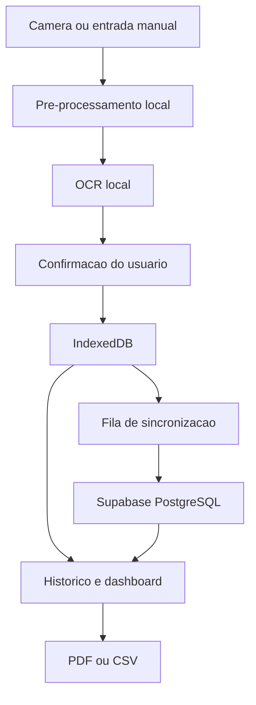

# Arquitetura — GlicoNexo

## Visão geral

O GlicoNexo é um PWA em Next.js (App Router) + TypeScript estrito. A
arquitetura alvo, descrita em `CLAUDE.md` (seção 6), processa a foto do
glicosímetro localmente no navegador (nunca no servidor), grava primeiro
no repositório local e sincroniza em segundo plano com o Supabase.



## Estado implementado nesta entrega (Fase 1)

Apenas a camada de apresentação e roteamento existe hoje:

- `src/app/(public)/*` — rotas públicas (landing, entrar, cadastro,
  recuperar senha, privacidade, termos).
- `src/app/onboarding` — fluxo de 4 passos, sem persistência.
- `src/app/(protected)/app/*` — casca do app autenticado, com todas as
  rotas do MVP (`início`, `registrar`, `histórico`, `histórico/[id]`,
  `análises`, `relatórios`, `configurações`, `privacidade`), navegação
  inferior no mobile e sidebar no desktop.
- `src/lib/supabase/client.ts` e `src/lib/supabase/server.ts` — clientes
  Supabase (browser/servidor) usando `@supabase/ssr`, prontos para receber
  credenciais reais.
- `src/features/measurements/schemas.ts` — schema Zod único, pensado para
  ser compartilhado entre o fluxo manual e o fluxo de confirmação OCR, como
  pede a regra 2 da seção 17 do `CLAUDE.md`.

**Nada é persistido ainda.** O formulário de registro manual valida e
exibe uma tela de confirmação, mas não grava em IndexedDB nem no Supabase
— isso está marcado explicitamente no código com `TODO (Fase N)` e é a
próxima etapa do roadmap.

## Camadas planejadas (fases seguintes)

Os componentes de UI não devem chamar o Supabase diretamente. As fases
seguintes devem introduzir:

```ts
interface MeasurementRepository {
  list(filters?: MeasurementFilters): Promise<GlucoseMeasurement[]>;
  getById(id: string): Promise<GlucoseMeasurement | null>;
  create(input: CreateMeasurementInput): Promise<GlucoseMeasurement>;
  update(id: string, input: UpdateMeasurementInput): Promise<GlucoseMeasurement>;
  remove(id: string): Promise<void>;
}

interface OcrProvider {
  recognize(input: Blob): Promise<OcrResult>;
}

interface SyncService {
  pushPending(): Promise<SyncSummary>;
  pullChanges(): Promise<SyncSummary>;
  sync(): Promise<SyncSummary>;
}
```

- `MeasurementRepository` — implementado sobre Dexie (IndexedDB) na Fase 3,
  cobrindo leitura local imediata e escrita otimista.
- `OcrProvider` — implementado com Tesseract.js na Fase 5, carregado sob
  demanda (o bundle principal não deve incluir o engine OCR).
- `SyncService` — outbox + fila de sincronização com o Supabase, criada na
  Fase 4, com UUID gerado no cliente para permitir criação offline
  idempotente.

## Decisões de Next.js 16

Este projeto foi criado com Next.js 16, que trouxe mudanças relevantes em
relação ao que a maioria dos modelos de IA "conhece" de treinamento (ver
`node_modules/next/dist/docs/`, referenciado em `AGENTS.md`):

- `cookies()` e `headers()` são assíncronos — `src/lib/supabase/server.ts`
  já usa `await cookies()`.
- Middleware foi renomeado para `proxy.ts` — ainda não existe neste
  projeto porque a validação de sessão no servidor (`CLAUDE.md`, seção 9)
  será implementada junto da autenticação real, na Fase 2.
- O manifest da PWA é gerado via `src/app/manifest.ts` (convenção nativa
  do App Router), não como um `public/manifest.webmanifest` estático.
- Turbopack é o bundler padrão para `dev` e `build`.

## Estratégia de conflito de sincronização (planejada)

Conforme `CLAUDE.md` seção 13: a versão otimista (`version`) evita
sobrescrita silenciosa. Para a primeira versão do MVP, "server wins" será
usado apenas para registros já sincronizados; alterações locais pendentes
nunca serão descartadas sem aviso ao usuário. Esta estratégia ainda não
foi implementada.

## Limitações conhecidas desta entrega

- Sem service worker: o app ainda não funciona offline de fato.
- Sem IndexedDB: nenhuma medição é persistida localmente.
- Sem RLS/migrations: não há banco real conectado.
- Sem OCR: a opção "Usar câmera" mostra um estado "em breve".
