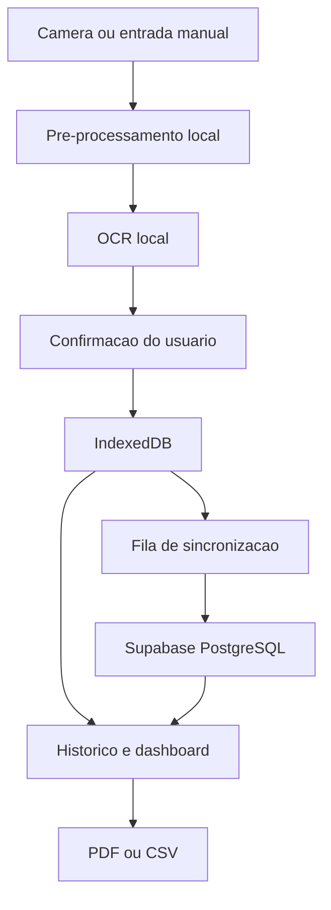

# Arquitetura — GlicoNexo

## Visão geral

O GlicoNexo é um PWA em Next.js (App Router) + TypeScript estrito. A
arquitetura alvo, descrita em `CLAUDE.md` (seção 6), processa a foto do
glicosímetro localmente no navegador (nunca no servidor), grava primeiro
no repositório local e sincroniza em segundo plano com o Supabase.



## Estado implementado nesta entrega (Fase 1, Fase 3 parcial, Fase 5, Fase 6 completa, exportação da Fase 7, Fase 8 parcial)

- `src/app/(public)/*` — rotas públicas (landing, entrar, cadastro,
  recuperar senha, privacidade, termos).
- `src/app/onboarding` — fluxo de 4 passos, sem persistência do aceite.
- `src/app/(protected)/app/*` — casca do app autenticado, com todas as
  rotas do MVP (`início`, `registrar`, `histórico`, `histórico/[id]`,
  `análises`, `relatórios`, `configurações`, `privacidade`), navegação
  inferior no mobile e sidebar no desktop.
- `src/lib/supabase/client.ts` e `src/lib/supabase/server.ts` — clientes
  Supabase (browser/servidor) usando `@supabase/ssr`, prontos para receber
  credenciais reais quando a conta do produto existir (ver
  `docs/database.md` — pendência registrada).
- `src/features/measurements/schemas.ts` — schema Zod único, compartilhado
  entre o fluxo manual e o futuro fluxo de confirmação OCR (regra 2 da
  seção 17 do `CLAUDE.md`).
- **`MeasurementRepository` sobre IndexedDB/Dexie** (`src/lib/db/`) — ver
  seção dedicada abaixo. Registrar, editar, excluir (com desfazer) e
  listar/filtrar medições já funciona de ponta a ponta, salvando de
  verdade no navegador.
- **`OcrProvider` implementado com Tesseract.js** (`src/features/ocr/`)
  — ver seção dedicada abaixo. Captura por câmera/arquivo, recorte,
  giro, pré-processamento e reconhecimento de dígitos já funcionam.
- Os três gráficos de Análises (linha temporal, série por contexto,
  quantidade por dia/contexto — todos Recharts, lazy) e exportação de
  dados (CSV/JSON) — ver `docs/telas.md` para o detalhe tela a tela e a
  seção "Paleta dos gráficos por contexto" abaixo.
- **Service worker real** (`public/sw.js`) com estratégia de cache por
  rota, página offline e atualização controlada — ver seção dedicada
  abaixo.

## Camada de dados local (implementada)

```ts
interface MeasurementRepository {
  list(filters?: MeasurementFilters): Promise<GlucoseMeasurement[]>;
  getById(id: string): Promise<GlucoseMeasurement | null>;
  create(input: CreateMeasurementInput): Promise<GlucoseMeasurement>;
  update(id: string, input: UpdateMeasurementInput): Promise<GlucoseMeasurement>;
  remove(id: string): Promise<void>;
}
```

`src/lib/db/measurement-repository.ts` implementa essa interface sobre
Dexie (`src/lib/db/schema.ts`, banco `gliconexo`, tabela `measurements`),
com um método extra `restore(id)` para o "desfazer" de exclusões
recentes na UI do histórico. Decisões relevantes:

- UUID gerado no cliente (`crypto.randomUUID()`) em `create`, permitindo
  registro offline idempotente quando a sincronização existir.
- Exclusão lógica (`deletedAt`) em vez de exclusão física, com `version`
  incrementado a cada `update`/`remove`/`restore` — já preparado para a
  estratégia de conflito otimista da Fase 4 (ver abaixo).
- `getDb()` instancia o Dexie sob demanda (nunca no import), porque
  `new Dexie(...)` exige `indexedDB`, que não existe durante a
  renderização no servidor (Next.js roda em Node).
- Componentes de UI leem os dados via `dexie-react-hooks`
  (`useLiveQuery`), não via `fetch`/estado manual — a tela atualiza
  sozinha quando outro componente grava no mesmo banco.
- Filtros (período/contexto/origem) e agrupamento por dia
  (`src/features/measurements/filter-measurements.ts`) e estatísticas
  (`src/features/measurements/stats.ts`) são funções puras, testadas em
  `tests/unit/`, mantendo essa lógica fora dos componentes visuais
  (CLAUDE.md, seção 6, "metricas devem ser funcoes puras e testadas").

**Ainda não implementado nesta camada:** nenhum dado é escopado por
`user_id` (não existe autenticação ainda — todo o dispositivo é uma
"conta local" única) nem limpo em um logout (que também não existe);
isso é trabalho da Fase 2/4, junto da privacidade local descrita na
seção 13 do `CLAUDE.md`. Nada sincroniza com o Supabase ainda — é por
isso que todo registro aparece com o selo "Pendente" no histórico.

## Câmera e OCR (implementado)

```ts
interface OcrProvider {
  recognize(input: Blob): Promise<OcrResult>;
}
```

O provider ativo em `CameraCaptureFlow` é
`src/features/ocr/seven-segment/seven-segment-provider.ts`
(`SevenSegmentOcrProvider`), dedicado a displays LCD de 7 segmentos
(glicosímetros digitais tipo Accu-Chek). Ele existe porque um OCR
genérico, mesmo restrito a dígitos, tende a confundir o número grande
central com números pequenos do mesmo visor (horário, contador de
memória). Todo o pipeline roda no navegador via
[OpenCV.js](https://github.com/TechStark/opencv-js) (WASM) — nenhuma
foto é enviada a um servidor, mesma regra do Tesseract.js abaixo.
Detalhado em `src/features/ocr/seven-segment/`:

1. **`detect-display.ts`** — detecta o quadrilátero do visor dentro do
   recorte que o usuário já fez manualmente em `image-editor.tsx` (não
   na foto inteira: um humano já excluiu mesa/corpo do aparelho, o que
   torna essa etapa muito mais robusta). Se não achar um quadrilátero
   confiável, retorna `null` sem lançar erro — a etapa seguinte
   simplesmente não corrige perspectiva.
2. **`correct-perspective.ts`** — `getPerspectiveTransform`/
   `warpPerspective` para endireitar o visor, quando um quadrilátero foi
   encontrado.
3. **`crop-main-reading.ts`** — agrupa contornos por linha (posição e
   altura verticais similares) e pontua cada grupo por área relativa,
   centralidade e penalidade por mais de 3 dígitos (leituras válidas são
   1–999) para escolher o cluster do número grande, ignorando relógio e
   contador de memória. `pickBestCluster`/`clusterContoursByRow`/
   `scoreCluster` são funções puras, testadas sem OpenCV
   (`tests/unit/seven-segment-cluster.test.ts`).
4. **`preprocess-display.ts`** — ponte `cv.Mat` ↔ `PixelBuffer`;
   reaproveita o mesmo `preprocess.ts`/`THRESHOLD_LEVELS` já usado pelo
   Tesseract, em vez de duplicar a lógica de contraste/limiar em OpenCV.
5. **`detect-digits.ts`** — segmenta a ROI binarizada em células de
   dígito individuais, fundindo fragmentos próximos (ex.: os dois traços
   do "4").
6. **`decode-seven-segment.ts`** — pura, sem OpenCV: amostra os 7
   segmentos de cada célula e decodifica via `SEGMENT_DIGIT_TABLE`.
   Nunca "chuta": qualquer padrão fora da tabela (ponto decimal, ícone de
   bateria, traço/sinal negativo) vira `null`. Testada em
   `tests/unit/seven-segment-decode.test.ts`.
7. **`validate-result.ts`** — rejeita a leitura inteira se qualquer
   dígito for `null` ou o valor final ficar fora de 1–999 (mesmo range
   de `parse-candidates.ts`). Testada em
   `tests/unit/seven-segment-validate.test.ts`.
8. **`ocr-fallback.ts`** — se a decodificação por segmentos falhar em
   todos os níveis de limiar, cai para o `TesseractOcrProvider` já
   existente (item abaixo), chamado **só com a ROI já recortada** do
   número grande — nunca a foto inteira.

`SevenSegmentOcrProvider.recognize()` nunca rejeita a Promise: qualquer
exceção em qualquer etapa (falha ao carregar o WASM, imagem
inadequada) resolve com `{ value: null, confidence: 0 }`, para que uma
falha de OCR nunca impeça a digitação manual (CLAUDE.md, regra de
negócio 15) — a tela de confirmação (`ManualEntryForm`) já trata esse
caso hoje. `SevenSegmentOcrProvider` chama `recognize()` diretamente em
`CameraCaptureFlow`, sem passar por `run-ocr-pipeline.ts`: ele já faz seu
próprio laço de níveis de limiar internamente, depois de recortar o
número grande (mais preciso que testar limiares antes desse recorte).
`run-ocr-pipeline.ts` continua existindo, usado pelos testes do
`TesseractOcrProvider` legado e disponível para um futuro provider mais
simples.

**Carregamento do OpenCV.js:** `opencv-loader.ts` importa
`@techstark/opencv-js` via `import()` dinâmico dentro de `loadOpenCv()`
— só baixa o chunk (alguns megabytes) na primeira vez que o usuário
efetivamente abre a câmera, nunca no bundle principal (mesma regra do
Tesseract.js abaixo). Diferente do Tesseract.js, que busca seu motor de
um CDN de terceiros, `@techstark/opencv-js` é um pacote npm normal:
o bundler do Next.js resolve e serve o `.wasm` a partir do próprio
domínio da aplicação (`_next/static/...`), então já é coberto pela regra
`cache-first` existente do service worker para esse prefixo, sem
precisar de nenhuma exceção nova em `public/sw.js`. **Pendência real:**
isso não foi validado rodando de fato (bundling de `.wasm` via
webpack/Turbopack é uma área historicamente cheia de armadilhas) —
precisa de um smoke test manual num navegador real antes de confiar
nessa etapa, e os testes de integração de
`tests/integration/seven-segment-provider.test.ts` (que exercitam o
pipeline completo com OpenCV.js real) também não puderam ser executados
nesta sandbox — ver `docs/testing.md`.

`src/features/ocr/tesseract-provider.ts` (`TesseractOcrProvider`)
continua existindo como implementação alternativa de `OcrProvider` e
como fallback interno do provider de 7 segmentos, com
[Tesseract.js](https://tesseract.projectnaptha.com/), atrás da mesma
interface sugerida em `CLAUDE.md` (seção 6) — trocar de motor de OCR no
futuro não deve exigir reescrever a tela de captura. Decisões
relevantes:

- `import("tesseract.js")` só acontece dentro de `getWorker()`, chamado
  pela primeira vez que o usuário efetivamente tira/seleciona uma foto
  — confirmado no build de produção: o chunk do Tesseract.js não
  aparece nas tags `<script>` de nenhuma página, nem mesmo
  `/app/registrar` (CLAUDE.md, seção 20, "bundle principal nao deve
  incluir engine OCR se o usuario nao abrir a camera").
- O reconhecimento é restrito a dígitos (`tessedit_char_whitelist:
  "0123456789"`), conforme CLAUDE.md 10.6.
- `src/features/ocr/preprocess.ts` implementa o pipeline de
  pré-processamento (escala de cinza → contraste → redução de ruído
  via mediana 3×3 → binarização) como funções puras operando sobre um
  formato compatível com `ImageData`, testáveis sem precisar de um
  `<canvas>` real. `src/features/ocr/run-ocr-pipeline.ts` testa 3
  níveis de limiar (`THRESHOLD_LEVELS`) e fica com o de maior
  confiança, parando cedo se achar um candidato de alta confiança —
  "testar variacoes de limiar e selecionar o candidato mais
  consistente" (CLAUDE.md 10.6).
- `src/features/ocr/parse-candidates.ts` extrai candidatos numéricos
  válidos (1–999) do texto bruto reconhecido; texto sem dígitos não
  gera candidato algum.
- `src/features/ocr/canvas-utils.ts` concentra as operações de canvas
  (girar, recortar, extrair/gravar pixels) usadas pelo editor de
  imagem.
- A foto (original, recortada e as variantes pré-processadas) só existe
  como `Blob`/`URL.createObjectURL` em memória — nunca é gravada no
  IndexedDB nem enviada a um servidor. Todo `object URL` temporário é
  revogado ao salvar, cancelar ou tentar novamente
  (`CameraCaptureFlow`).
- **Dependência externa:** o motor (WebAssembly) e o modelo de idioma
  são baixados do CDN público do Tesseract.js na primeira execução
  neste dispositivo — não há dado do usuário nessa chamada, mas é uma
  dependência de terceiros que exige internet nesse momento. Ver
  `docs/privacy-and-security.md`.

## Service worker e cache (implementado)

`public/sw.js` é um arquivo estático escrito à mão, sem passar por
nenhuma etapa de build — decisão deliberada, não a opção "padrão" da
`CLAUDE.md` (que sugere Serwist). O motivo:

- Este projeto roda em Next.js 16 com **Turbopack** como bundler padrão
  (`dev` e `build`). O plugin de build do Serwist (`@serwist/next`) é
  baseado em webpack e explicitamente não funciona sob Turbopack (avisa
  isso em tempo de build — ver
  [serwist/serwist#54](https://github.com/serwist/serwist/issues/54)).
- A alternativa oficial para Turbopack, `@serwist/turbopack`, resolve
  isso servindo o worker através de uma Route Handler que empacota o
  arquivo com `esbuild`/`esbuild-wasm` **em tempo de execução**, a cada
  requisição — o próprio pacote se descreve, no código-fonte, como um
  "workaround... enquanto plugins ainda não são suportados" no
  Turbopack.
- Para um app que processa dados de saúde, uma cadeia experimental
  (empacotamento dinâmico via WASM dentro de uma rota, especificamente
  para o arquivo que decide o que fica em cache) pareceu um risco maior
  do que um arquivo JavaScript simples, estático, curto e auditável à
  mão. Isso é revisado quando o suporte a Turbopack no Serwist sair do
  estágio experimental.

Consequência prática: não há geração automática de um manifest de
precache com hash de conteúdo (o que o Serwist faria sozinho). Em vez
disso, `CACHE_VERSION` (no topo de `public/sw.js`) precisa ser
incrementado manualmente sempre que uma mudança no arquivo exigir
invalidar caches antigos — o `activate` do worker apaga qualquer cache
`gliconexo-*` que não bata com a versão atual.

Estratégias por rota, implementadas no listener `fetch`:

- **`cache-first`**: `/icons/*`, `/logo/*`, `/_next/static/*` (chunks
  com hash, imutáveis), `/manifest.webmanifest` e os ícones gerados por
  convenção do Next (`/icon.png`, `/apple-icon.png`).
- **`stale-while-revalidate`**: navegação para páginas públicas (`/`,
  `/entrar`, `/cadastro`, `/recuperar-senha`, `/privacidade`, `/termos`,
  `/onboarding`) — responde do cache instantaneamente quando existir, e
  atualiza o cache em segundo plano.
- **Somente rede, nunca interceptado nem cacheado**: qualquer caminho
  sob `/app/*` (autenticado, com dados de glicemia) e qualquer caminho
  sob `/auth`/`/api` — CLAUDE.md, seção 14, "nao cachear HTML autenticado
  com dados privados no service worker". Em navegação para `/app/*` sem
  rede disponível, a única coisa servida é a página `/offline`
  pré-cacheada (nunca uma resposta autenticada antiga).
- **Nunca intercepta origem cruzada** (`url.origin !== self.location.origin`
  faz o `fetch` handler devolver o controle ao navegador sem tocar na
  requisição) — protege explicitamente o download do motor/modelo do
  Tesseract.js via CDN de qualquer interferência do service worker. O
  WASM do OpenCV.js (usado pelo leitor de 7 segmentos, ver "Câmera e
  OCR") não precisa dessa exceção: é servido same-origin via
  `_next/static/`, já coberto pela regra `cache-first` acima.
- Só requisições `GET` são interceptadas; qualquer outro método passa
  direto.

Atualização: o worker novo fica em estado "waiting" até o cliente mandar
`{ type: "SKIP_WAITING" }` (`src/lib/pwa/use-service-worker.ts` +
`src/components/pwa/update-available-banner.tsx`) — nunca troca de
versão sozinho enquanto o usuário está usando o app. O registro só
acontece em produção (`process.env.NODE_ENV === "production"`), nunca em
`next dev`, para não brigar com o hot reload do Turbopack.

**Verificado nesta entrega** com Playwright contra o build de produção:
o worker registra e ativa; com o processo do `next start` derrubado de
propósito (falha de rede real, não simulada por CDP), uma página pública
já visitada continua respondendo do cache e uma rota protegida nunca
visitada mostra `/offline` sem vazar conteúdo antigo; alterando o
conteúdo de `sw.js` e chamando `registration.update()`, o aviso de nova
versão aparece e o botão "Atualizar agora" troca o controlador da
página. (Nota de metodologia: `context.setOffline()`/`context.route()`
do Playwright não interceptam de forma confiável requisições feitas
*de dentro* do service worker nesta versão — por isso a verificação
usou uma falha de rede real, derrubando o servidor, em vez de emulação.)

## Paleta dos gráficos por contexto (implementado)

Os dois gráficos novos de Análises (`ContextSeriesChart`,
`DailyContextChart` — CLAUDE.md 10.11) precisam de 5 cores categóricas,
uma por "balde" de contexto: café da manhã, almoço, lanche da tarde,
jantar, e outros contextos (jejum, madrugada, antes de dormir, atividade
física e outro, agrupados — `src/features/measurements/context-buckets.ts`,
`bucketForContext`). Essas cores foram escolhidas e validadas com o
script `validate_palette.js` do skill de dataviz interno, em vez de
escolhidas de olho, pelos seguintes motivos:

- **Não podem ser confundidas entre si.** Validado no pairlist adjacente
  (a ordem de exibição na legenda/linhas) tanto em claro quanto em
  escuro: banda de luminosidade OKLCH, piso de croma, separação sob
  simulação de daltonismo (Delta E OKLab) e piso de visão normal — ver
  `scripts/validate_palette.js` no skill para os limiares exatos.
- **Não podem ser confundidas com as cores de status** já usadas na
  mesma tela (`--status-below`/`--status-within`/`--status-above`, o
  vermelho/verde/laranja de "abaixo/dentro/acima da faixa"). Cada uma
  das 5 cores categóricas foi conferida isoladamente contra as três
  cores de status, em ambos os temas, antes de entrar na paleta final.
- **Onde há contraste baixo contra o fundo do gráfico** (3 das 5 cores em
  modo claro), a "válvula de escape" documentada pelo skill é usada:
  rótulos visíveis sempre presentes (legenda própria + tooltip) e uma
  tabela de dados equivalente — nunca depender só da cor.

Tokens em `src/app/globals.css` (`--series-context-1` a `-5`, expostos
como `--color-series-context-*` via `@theme inline`, seguindo o mesmo
padrão dos tokens de marca/status já existentes):

| Balde | Claro | Escuro |
| --- | --- | --- |
| Café da manhã | `#1e9af3` | `#3987e5` |
| Almoço | `#92400e` | `#c2760f` |
| Lanche da tarde | `#0891b2` | `#0891b2` |
| Jantar | `#4a3aa7` | `#9085e9` |
| Outros contextos | `#e87ba4` | `#d55181` |

A legenda é construída à mão (`ContextBucketLegend`) em vez de usar o
componente `<Legend>` nativo do Recharts: o nativo reordenava as
entradas (aparentemente por ordem alfabética do rótulo) em vez de manter
a ordem fixa dos baldes, e renderizar os dois ao mesmo tempo criava uma
legenda duplicada — bug encontrado e corrigido durante a revisão visual
desta entrega.

## Camadas ainda planejadas (fases seguintes)

```ts
interface SyncService {
  pushPending(): Promise<SyncSummary>;
  pullChanges(): Promise<SyncSummary>;
  sync(): Promise<SyncSummary>;
}
```

- `SyncService` — outbox + fila de sincronização com o Supabase, criada na
  Fase 4, reaproveitando o `version`/`deletedAt` já presentes no schema
  local.

## Decisões de Next.js 16

Este projeto foi criado com Next.js 16, que trouxe mudanças relevantes em
relação ao que a maioria dos modelos de IA "conhece" de treinamento (ver
`node_modules/next/dist/docs/`, referenciado em `AGENTS.md`):

- `cookies()` e `headers()` são assíncronos — `src/lib/supabase/server.ts`
  já usa `await cookies()`.
- Middleware foi renomeado para `proxy.ts` — ainda não existe neste
  projeto porque a validação de sessão no servidor (`CLAUDE.md`, seção 9)
  será implementada junto da autenticação real, na Fase 2.
- O manifest da PWA é gerado via `src/app/manifest.ts` (convenção nativa
  do App Router), não como um `public/manifest.webmanifest` estático.
- Turbopack é o bundler padrão para `dev` e `build`.

## Estratégia de conflito de sincronização (planejada)

Conforme `CLAUDE.md` seção 13: a versão otimista (`version`) evita
sobrescrita silenciosa. Para a primeira versão do MVP, "server wins" será
usado apenas para registros já sincronizados; alterações locais pendentes
nunca serão descartadas sem aviso ao usuário. Esta estratégia ainda não
foi implementada.

## Limitações conhecidas desta entrega

- O service worker cobre o shell público e os assets estáticos, mas o
  motor de OCR ainda precisa de internet na primeira vez que é usado em
  cada dispositivo (dependência de CDN externa, ver "Câmera e OCR"
  acima) — isso é intencionalmente fora do escopo do service worker
  (`url.origin !== self.location.origin` nunca é interceptado).
- Uma primeira visita **totalmente** offline (nunca abriu o app antes,
  neste dispositivo) não tem nada para mostrar — é uma limitação
  inerente a qualquer PWA baseado em service worker, não deste em
  particular.
- Sem Content Security Policy: os cabeçalhos de segurança "seguros"
  (`X-Content-Type-Options`, `Referrer-Policy`, `Permissions-Policy`)
  já estão ativos (`next.config.ts`), mas uma CSP completa foi
  propositalmente deixada de fora — ver `docs/privacy-and-security.md`.
- Dados locais não são escopados por usuário nem sincronizam entre
  dispositivos — só existe uma "conta local" por navegador.
- Sem RLS/migrations: não há banco remoto real conectado (pendência de
  produto registrada em `docs/database.md`).
- Os três gráficos da Fase 6 (linha temporal, série por contexto,
  quantidade por dia/contexto) estão completos; falta filtro por
  contexto e "mês atual" em Análises (fora do escopo original da Fase 6).
  Exportação em PDF ainda não existe (resto da Fase 7).
- Testes cross-browser reais (Safari iOS, Chrome Android em hardware
  físico) ainda não foram feitos — só Chromium via Playwright, contra o
  build de produção.
