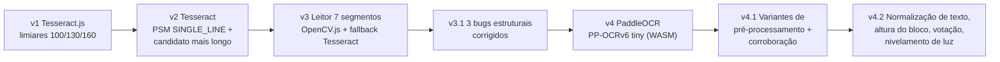

# Histórico de correções e evolução do OCR

> Levantado a partir do histórico do Git (commits de 28/08/2026 a 03/09/2026) e das
> alterações ainda não commitadas na branch `claude/gliconexo-logo-42ibsn`.
> Itens marcados como **(não commitado)** estão no working tree, sem commit.

## 1. Resumo

| # | Problema | Área | Commit |
|---|----------|------|--------|
| 1 | Tela em branco depois de salvar medição via OCR | OCR / UI | `d004042` |
| 2 | Formulários de login/cadastro falhavam em silêncio | Auth | `9fbb57d` |
| 3 | Não havia botão de sair | Auth | `1661e55` |
| 4 | Câmera lia o número errado | OCR | `8eef47a` |
| 5 | Menu inferior espremido e anel do botão "Registrar" cortado | UI | `83e57af`, `d056c0d` |
| 6 | OpenCV.js não compilava no Turbopack | Build | `b2a77c3` |
| 7 | Pixels embaralhados ao recortar `cv.Mat` + erros de typecheck | OCR | `e71b2ee` |
| 8 | Decodificador de 7 segmentos sempre falhava | OCR | `f396a5c` |
| 9 | Foto real com reflexo não era lida por nenhum motor | OCR | `10d4f8a` |
| 10 | Fotos borradas ou com pouco contraste | OCR | **(não commitado)** |
| 10b | Letras lidas no lugar de dígitos, dígitos separados, relógio escolhido como valor, reflexo | OCR | **(não commitado)** |
| 11 | Dados locais compartilhados entre contas no mesmo aparelho | Privacidade | **(não commitado)** |
| 12 | Rotas protegidas sem validação de sessão no servidor | Auth | **(não commitado)** |

## 2. Erros corrigidos fora do OCR

### 2.1 Tela em branco após salvar via OCR (`d004042`)
- **Sintoma:** depois de confirmar uma leitura da câmera, a tela ficava vazia.
- **Causa:** a renderização da tela de confirmação dependia da URL da imagem temporária,
  e essa URL era limpa no próprio salvamento.
- **Correção:** a renderização deixou de depender dessa URL.

### 2.2 Autenticação falhando em silêncio (`9fbb57d`)
- **Sintoma:** clicar em "Entrar" ou "Criar conta" não fazia nada.
- **Causa:** quando o cliente Supabase não inicializava (por exemplo, com variáveis de
  ambiente ausentes), a chamada lançava uma exceção que ninguém tratava.
- **Correção:** o erro é capturado em `login-form`, `signup-form` e `reset-password-form`,
  e o formulário mostra uma mensagem ao usuário.

### 2.3 Login anônimo e logout (`1661e55`)
- Adicionados o botão "Entrar como visitante" (`signInAnonymously`) e o botão "Sair",
  que ainda não existia.
- **Depende de configuração:** a opção "Enable Anonymous Sign-Ins" precisa estar ativada
  no projeto Supabase.

### 2.4 Menu inferior mobile (`83e57af`, `d056c0d`)
- A barra tinha 56 px e os itens ficavam espremidos. Ela passou para 72 px, e o
  `padding-bottom` do layout foi ajustado para acompanhar.
- O anel (`ring-4`) do botão "Registrar" usava a cor de fundo da página e não a da barra.
  Isso desenhava uma linha cortando o círculo. Trocado para `ring-surface`.

### 2.5 OpenCV.js no Turbopack (`b2a77c3`)
- **Sintoma:** o build falhava porque o `@techstark/opencv-js` faz `require("fs")`,
  `"path"` e `"crypto"` num trecho de código que só roda no Node.
- **Correção:** `turbopack.resolveAlias` no `next.config.ts` aponta os três módulos para
  `empty-node-module.js`. O mesmo commit tirou do Git o `npm-install.log`, que tinha sido
  commitado por engano, e o adicionou ao `.gitignore`.

### 2.6 Isolamento de dados locais por usuário **(não commitado)**
- **Risco:** o IndexedDB tinha um nome fixo (`gliconexo`). Duas contas no mesmo aparelho
  veriam os dados uma da outra, o que viola a regra 13 do CLAUDE.md.
- **Correção:** agora cada usuário tem o próprio banco, `gliconexo-<userId>`. Os arquivos
  envolvidos são `src/lib/db/schema.ts`, com `setActiveUser` e
  `clearActiveUserLocalData`, e `src/lib/db/local-db-user-sync.tsx`.
- `setActiveUser` é chamado **durante o render**, não num efeito. Assim se evita a corrida
  com repositórios que já leem dados ao montar.

### 2.7 Sessão validada no servidor e exclusão de conta **(não commitado)**
- `src/middleware.ts` e `src/lib/supabase/middleware.ts` renovam a sessão.
  `src/app/(protected)/layout.tsx` chama `auth.getUser()` e redireciona para `/entrar`
  quando não há usuário.
- `POST /api/account/delete` (hoje substituída por `POST /api/conta/excluir`, depois do merge `e3e4538`) identifica o usuário só pela sessão, sem aceitar `user_id`
  do cliente. Ele usa `src/lib/supabase/admin.ts`, marcado como `server-only`, e sempre
  devolve respostas genéricas.
- Os registros de consentimento (`consent_records`) usam `on delete cascade`.
- Em 15/10/2026 foi constatado que nenhum aceite de termos tinha sido gravado
  (0 registros para 44 usuários): o upsert de `recordTermsConsent` usava
  `on conflict (user_id, consent_type, document_version)`, mas o banco não tinha
  essa restrição única nem default em `accepted_at`, e o erro era ignorado.
  A migration local `20260909000000_consent_records.sql` nunca tinha sido aplicada
  (e falharia, porque recriava policies existentes). Ela foi substituída por
  `20261015021929_consent_records_upsert.sql`, aplicada no banco, e as 6 migrations
  base (antes só na branch do commit `a44a3d5`) voltaram ao repositório com as
  versões do banco. `recordTermsConsent` agora verifica o erro e retorna `false`
  sem impedir o login.

## 3. Evolução da leitura de imagem (OCR)

### Linha do tempo

### 3.1 v1: Tesseract.js com varredura de limiar (`d004042`)
- Pipeline local: escala de cinza, contraste, redução de ruído e binarização em 3 limiares
  (`THRESHOLD_LEVELS = [100, 130, 160]`). Fica o resultado de maior confiança e o laço para
  cedo quando a confiança passa de `HIGH_CONFIDENCE` (0,85).
- Nesse ambiente não foi possível validar o reconhecimento de ponta a ponta, porque o proxy
  bloqueava o CDN do Tesseract.

### 3.2 v2: número errado na câmera (`8eef47a`)
Havia dois problemas:
1. **Escolha do candidato:** `pickBestCandidate` pegava o primeiro número em ordem de
   leitura. Ruído, como traços e bordas do visor, virava um "dígito" solto antes do valor
   real e ganhava a disputa. **Correção:** prioriza o candidato com mais dígitos e usa a
   ordem só para desempate.
2. **Segmentação:** o Tesseract tratava o recorte como uma página inteira e quebrava o
   número em blocos separados. **Correção:** `PSM.SINGLE_LINE`.

### 3.3 v3: leitor dedicado de 7 segmentos (`4153f9d`, `3112c33`)
- Código em `src/features/ocr/seven-segment/`, com OpenCV.js em WASM. O leitor detecta o
  visor, corrige a perspectiva e isola o número grande central, ignorando o relógio e o
  contador de memória. Depois decodifica dígito a dígito e, se falhar, usa o Tesseract
  restrito à mesma região.
- Foi adicionada uma imagem sintética de teste, `public/tmp-test/accu-chek-103.png`.

### 3.4 v3.1: por que o leitor de 7 segmentos nunca funcionava (`e71b2ee`, `f396a5c`)
Na prática, o leitor falhava **sempre e em silêncio**. Toda leitura caía no fallback do
Tesseract. Foram encontradas quatro causas:

| Bug | Efeito | Correção |
|-----|--------|----------|
| `roi().clone()` informava `step`/`isContinuous` inconsistentes com o buffer | Linhas da imagem recortada saíam embaralhadas, o que quebrava os dois motores | Os pixels passaram a ser lidos com `cv.imshow()` + canvas, e não copiando `mat.data` |
| `cv.findContours` recebia uma Mat RGBA (`CV_8UC4`) | A função exige 1 canal (`CV_8UC1`) e falhava | Conversão para 1 canal antes dos contornos |
| Polaridade do threshold invertida | O fundo virava primeiro plano e os dígitos viravam "buracos", o que gerava um único contorno cobrindo a imagem inteira | Polaridade corrigida |
| Fusão de fragmentos agressiva demais | A fusão foi pensada para juntar partes do mesmo dígito (a "bandeira" do 1), mas também juntava dígitos vizinhos | Critério de fusão ajustado |

Resultado: com a foto sintética limpa, o próprio decodificador primário passou a ler "103"
com confiança alta.

Também entraram melhorias de uso: um botão para **remover a foto** na tela de confirmação,
que mantém o valor, e uma orientação mais clara quando a confiança é baixa ("tire outra
foto com mais luz e sem reflexo").

### 3.5 v4: troca para PaddleOCR (`10d4f8a`)
- **Motivo:** mesmo com as correções, uma **foto real com reflexo forte** no visor não era
  lida por nenhum dos dois motores.
- **Nova abordagem:** `PaddleOcrProvider` (pacote `ppu-paddle-ocr`, modelo PP-OCRv6 tiny,
  com `onnxruntime-web`/WASM), rodando 100% no navegador. Esse detector de texto genérico
  encontra **todos** os blocos do visor. `pickMainReading` escolhe o de maior área e usa
  `parse-candidates.ts` para extrair valores válidos entre 1 e 999.
- **Resultado:** a foto problemática passou a ser lida como "103" com confiança alta, e o
  caso sintético não piorou.
- O leitor de 7 segmentos e o Tesseract **continuam no repositório** como referência e
  backup, a pedido, mas o app não os chama mais.
- **Consequência:** no primeiro uso em cada aparelho, os pesos do modelo (~6 MB) são
  baixados do Hugging Face. A foto **não** é enviada a lugar nenhum.

### 3.6 v4.1: variantes de pré-processamento e corroboração **(não commitado)**
Objetivo: melhorar a leitura de fotos **borradas** (foco ruim ou mão tremendo) e com
**pouco contraste**.

- **Novo filtro `sharpen`**, uma máscara de nitidez 3x3, em `src/features/ocr/preprocess.ts`.
- **Variantes para o PaddleOCR**, em `src/features/ocr/paddle-preprocess-variants.ts`,
  testadas em ordem:
  1. `original`: a foto sem alteração, para não piorar fotos que já estão boas;
  2. `contrast-sharpen`: cinza, contraste 1,25 e nitidez;
  3. `denoise-contrast`: cinza, contraste 1,15 e redução de ruído.

  Essas variantes **não usam binarização** de propósito. O PaddleOCR é uma rede neural que
  depende do antialiasing dos traços, e um limiar binário (bom para 7 segmentos) tende a
  piorar o resultado.
- **Pipeline generalizado:** `runOcrPipelineWithVariants`, em `run-ocr-pipeline.ts`, recebe
  qualquer lista de variantes. O `runOcrPipeline` antigo virou um wrapper para os limiares.
- **Corroboração de confiança:** quando mais de uma variante rodou e só uma chegou a um
  valor, a confiança fica limitada a 0,69, abaixo de "alta". Com isso, uma leitura isolada
  e possivelmente errada nunca aparece como segura na tela de confirmação.
- **Lógica pura e testável:** `foldAttempt`, `finalizeAttempts` e `resolveAttempts` não
  dependem de canvas. Os testes ficam em `tests/unit/run-ocr-pipeline.test.ts` e
  `tests/unit/ocr-preprocess.test.ts`.
- **UI:** o progresso mostra "Reconhecendo o valor... (tentativa X de 3)".

Custo: uma foto difícil pode fazer o OCR rodar até 3 vezes. Fotos boas param na primeira
tentativa quando a confiança passa de 0,85.

### 3.7 v4.2: texto, escolha do bloco, votação e reflexo **(não commitado)**

| Problema | Exemplo | Correção | Onde |
|----------|---------|----------|------|
| O OCR genérico lê letras no lugar de dígitos de 7 segmentos | `1O3` virava os números 1 e 3; `1:54` virava `1S` | `normalizeLookalikeDigits` troca O/D→0, I/l→1, S→5, B→8 etc., **só em trechos que já têm um dígito** (`mg/dL`, `LO`, `Accu-CHEK` ficam intactos) | `parse-candidates.ts` |
| O vão entre dígitos do visor vira espaço | `1 03` virava 1 e 3 | `joinSplitDigitGroups` junta grupos separados por espaço quando o resultado tem 2 ou 3 dígitos; nunca junta `:` (relógio) | `parse-candidates.ts` |
| O relógio largo podia ganhar do valor principal | `12:45` com mais área que `96` num recorte folgado | O bloco principal passa a ser o **mais alto** (tamanho da fonte), com a área como desempate | `paddle-ocr-provider.ts` |
| Uma leitura isolada mais confiante vencia um consenso | 170 (0,7) vencia 120 (0,5) + 120 (0,45) | **Votação ponderada**: soma a confiança por valor. A confiança exibida continua sendo a maior individual, e os demais valores viram candidatos | `run-ocr-pipeline.ts` |
| Reflexo e luz irregular no visor | Foto real com reflexo (motivo da troca para o PaddleOCR) | `flattenIllumination`: divide cada pixel pela média local (imagem integral, O(n)), deixando o fundo uniforme e os traços escuros | `preprocess.ts` |
| O contraste fixo não se adapta a fotos escuras ou lavadas | — | `stretchContrast`: auto-níveis por percentil (1%–99%) | `preprocess.ts` |
| Visor com luz de fundo (dígito claro sobre fundo escuro) | — | Variante `inverted`, que só roda quando a luminância média é menor que 100 (campo `when` em `PreprocessVariant`) | `paddle-preprocess-variants.ts` |

Nova ordem das variantes: `original` → `flatten-illumination` → `stretch-sharpen` →
`denoise-stretch` → `inverted` (só em fotos escuras). A tela mostra
"tentativa X de N", contando só as variantes aplicáveis.

**Verificação:** 52 testes unitários de OCR passaram (parser, provider, pipeline e
pré-processamento), e typecheck e lint estão limpos. A suíte foi rodada com
`environment: "node"`, porque o `node_modules` local está com o `css-tree` (dependência do
jsdom) incompleto, o que impede a config padrão do vitest de iniciar. Isso **ainda não foi
testado com fotos reais no app**.

## 4. Lições aprendidas

- **Falha silenciosa esconde bugs.** O leitor de 7 segmentos passou vários commits
  "funcionando" só porque o fallback cobria as falhas. Vale registrar qual motor ou variante
  produziu o resultado, sem registrar o valor lido.
- **Imagem sintética não basta.** O caso limpo passava, mas a foto real com reflexo falhava.
  É preciso ter fixtures de fotos reais, anonimizadas e com consentimento.
- **O pré-processamento depende do motor.** A binarização ajuda um decodificador clássico e
  atrapalha uma rede neural.
- **Confiança alta de uma única leitura engana.** A concordância entre variantes é um sinal
  melhor.
- **A regra de ouro continua valendo:** o valor nunca é salvo automaticamente, e uma falha
  de OCR nunca bloqueia a digitação manual.

## 5. Pendências

- Commitar e validar os itens **(não commitado)** acima, rodando lint, typecheck, testes e
  build.
- Reinstalar as dependências (`npm ci`): o `css-tree` está incompleto em `node_modules`, e a
  suíte com jsdom não inicia.
- Validar a v4.2 com a foto real com reflexo e com fotos borradas, no celular (tempo por
  tentativa em aparelho intermediário).
- Montar um conjunto de fotos reais de teste (reflexo, desfoque, pouca luz, modelos
  diferentes de glicosímetro) para medir a taxa de acerto por variante.
- Decidir o destino do leitor de 7 segmentos e do Tesseract, que continuam no bundle ou
  repositório sem uso. Isso pesa no tamanho e na manutenção.
- Explicar ao usuário que o PaddleOCR precisa de internet no primeiro uso, porque o
  download do modelo impede o OCR offline na primeira vez.
- Remover `public/tmp-test/` do build de produção, se ainda estiver sendo publicado.
